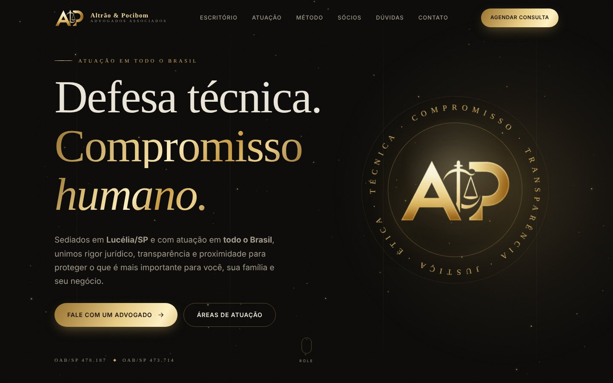

# Altrão & Pocibom Advogados — Website

Institutional website for **Altrão & Pocibom Advogados Associados**, a law firm based in Lucélia/SP, Brazil, that serves clients across the country.

Built by [Leonardo Santos](https://www.linkedin.com/in/leonardo-santos-048394281) with Claude Code. Published with the firm's authorization.



## The problem

The firm needed a single place where potential clients could understand its practice areas, meet the lawyers and get in touch, with a presence that matched its premium visual identity.

## The solution

A fast, single-page site with no backend, in Portuguese, that:

- presents the firm, its six practice areas, its working method and the two partners;
- answers frequent questions (first consultation, service outside Lucélia, documents, case follow-up, fees);
- sends every contact straight to the chosen lawyer's WhatsApp, which is how local clients prefer to talk;
- follows the advertising rules for Brazilian lawyers (OAB Provision 205/2021): informative content only, no promises of results.


## Features

- Responsive layout for phones, tablets and desktops
- Contact form that builds the message and opens WhatsApp with the selected lawyer, with a phone input mask
- Floating WhatsApp menu with both lawyers
- Practice-area cards that open detail modals, plus an animated FAQ accordion
- Scroll-reveal animations, counters, parallax, 3D tilt on the emblem and lawyer cards, gold particle background
- Accessibility: skip link, semantic sections, ARIA on menus and modals
- SEO: meta tags and Schema.org `LegalService` data
- Embedded Google Maps location

## Stack

- HTML5, CSS3 and vanilla JavaScript, with no frameworks and no build step
- Google Fonts (Cinzel, Cormorant Garamond, Manrope)
- Developed with **Claude Code**, from layout to QA. A layout audit script checked for overflow and clipped text at multiple screen sizes.

## Run locally

```bash
git clone https://github.com/Leocpsantos/site-altrao-pocibom-advogados.git
cd site-altrao-pocibom-advogados
python -m http.server 8000
```

Then open http://localhost:8000. Opening `index.html` directly in the browser also works.

## Project structure

```
index.html
assets/
  css/style.css
  js/main.js
  img/            logos and partner photos
docs/             screenshots and the launch social media post
```

## Brand material

I also designed the launch post for the firm's Instagram, using the same visual identity.


## Status

Ready for launch; deployment to production is pending.

---

🇧🇷 **Em português:** site institucional do escritório Altrão & Pocibom Advogados Associados, de Lucélia/SP. É uma página única, responsiva, feita em HTML, CSS e JavaScript com Claude Code. O formulário de contato envia a mensagem direto para o WhatsApp do advogado escolhido. Publicado com autorização do escritório.

© Altrão & Pocibom Advogados Associados. Names, logos and photos belong to the firm.
